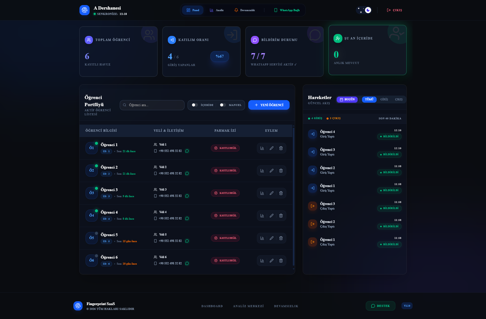
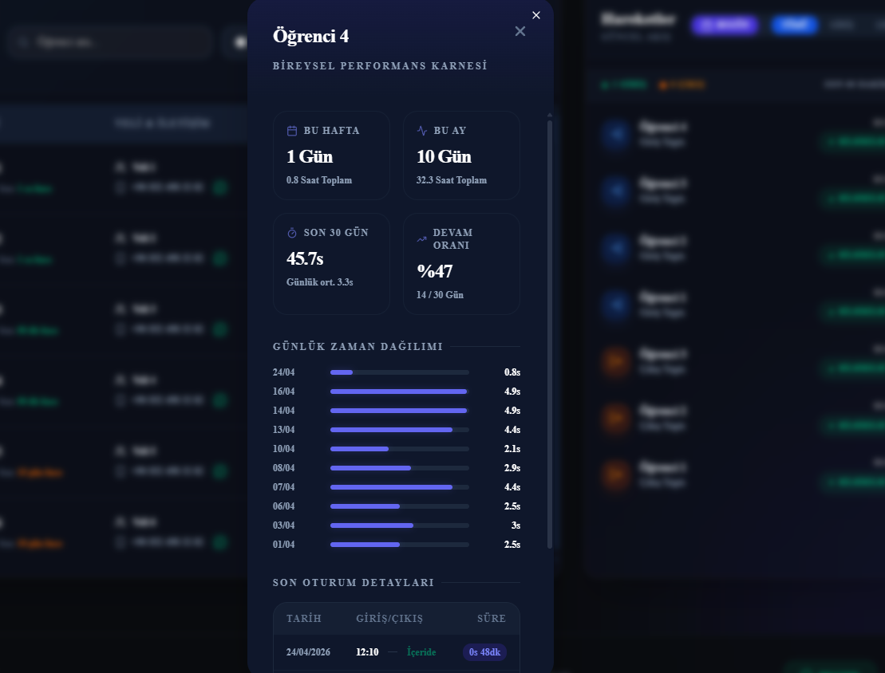
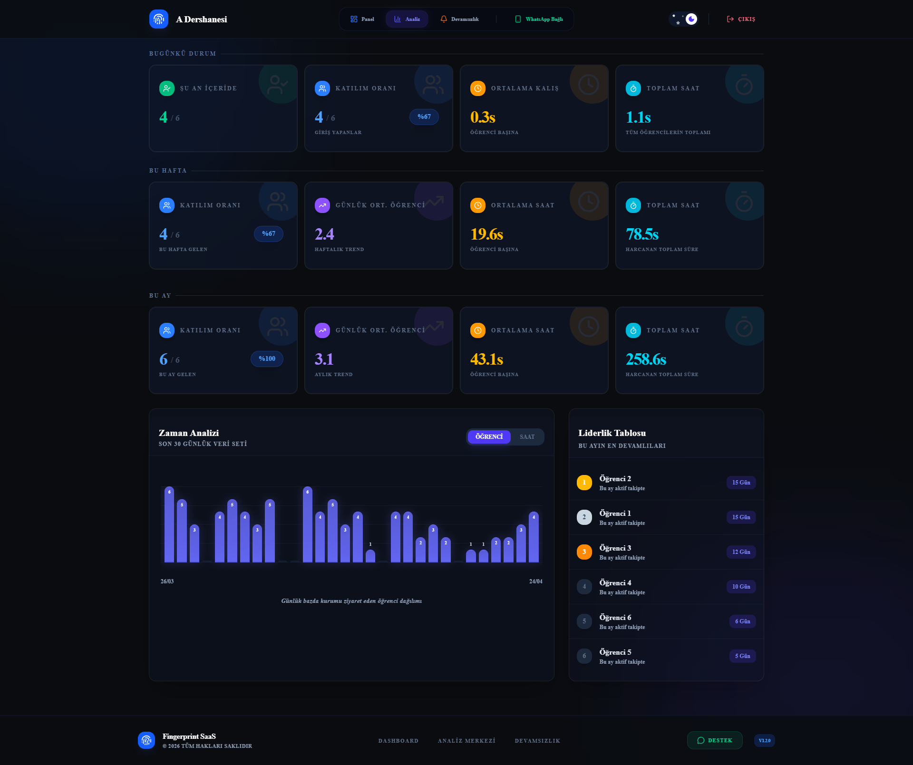
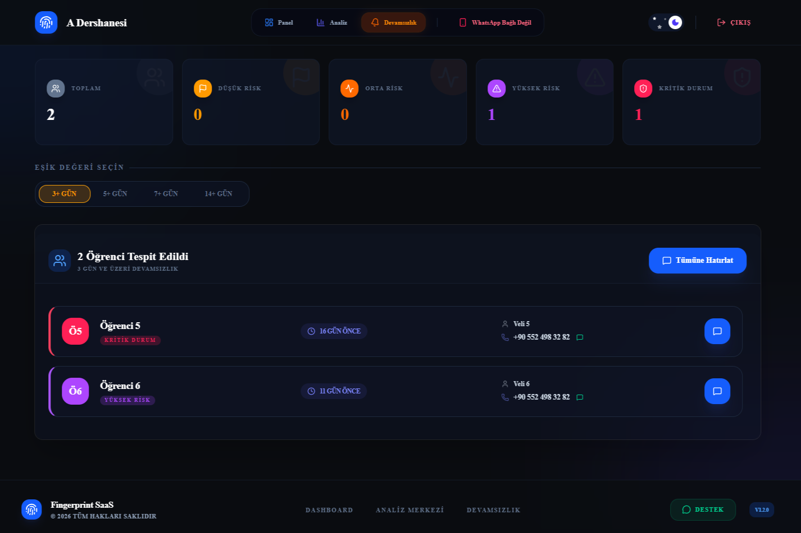

<div align="center">

# bura.da

**Dershaneler için parmak izi ile yoklama ve veli bilgilendirme sistemi**

Öğrenci parmak izi okuttuğu anda giriş/çıkış kaydedilir, veliye WhatsApp veya SMS ile anında bildirim gider.
Kurum yönetimi tüm şubeleri, istatistikleri ve devamsızlıkları tek panelden takip eder.

🌐 **[ahmetyorat.com.tr](https://ahmetyorat.com.tr/)**

</div>

> [!NOTE]
> Bu depo yalnızca bir **vitrindir**. bura.da ticari bir üründür; kaynak kodu gizlidir ve bu depoda yer almaz.
> Demo ve satın alma için web sitesi üzerinden iletişime geçebilirsiniz.

---

## Ekran Görüntüleri

### Yönetim Paneli
Kurumun anlık doluluk durumu, canlı giriş/çıkış akışı, WhatsApp ve cihaz bağlantı durumu.



### Öğrenci Karnesi
Öğrenci bazında ortalama kalış süresi, son 30 günlük katılım trendi, zaman dağılımı ve geçmiş kayıtlar.



### Analiz Merkezi
Toplam/ortalama kalış süresi, günlük öğrenci ortalaması, katılım oranı ve zirve saat tespiti.



### Devamsızlık Takibi
Gelmeyen öğrencilerin otomatik tespiti, "riskli" gruplandırma ve toplu veli bilgilendirme.



---

## Özellikler

- **Parmak izi cihaz entegrasyonu** — Kurumdaki biyometrik cihazlardan buluta kesintisiz veri aktarımı. İnternet kesildiğinde kayıtlar cihazda birikir, bağlantı gelince otomatik senkronize olur.
- **WhatsApp bildirimleri** — Giriş/çıkışta veliye, QR kod ile bağlanan kurum WhatsApp hesabından otomatik mesaj.
- **SMS bildirimleri** — WhatsApp yerine veya onunla birlikte SMS ile bildirim.
- **Aylık karne** — Her ay velilere öğrencinin aylık karnesi, kurum yöneticisine kurumsal özet rapor otomatik gönderilir.
- **İstatistikler** — Kalış süreleri, katılım trendleri, zirve saatler.
- **Devamsızlık takibi** — Otomatik tespit, riskli öğrenci grubu, toplu veli bilgilendirme.
- **Ders programları** — Şube/sınıf bazlı program yönetimi.
- **Çoklu şube** — Kurum yöneticisi tüm şubelerini tek hesaptan yönetir.
- **Çok kiracılı SaaS mimarisi** — Tek altyapı üzerinden birden fazla kuruma hizmet.

### SMS Desteği

Her kurum, veli bildirimlerinin hangi kanaldan gideceğini kendisi seçer:

| Bildirim yöntemi | Davranış |
|---|---|
| WhatsApp (varsayılan) | Yalnızca WhatsApp |
| SMS | Yalnızca SMS |
| İkisi birden | WhatsApp + SMS |

- **Desteklenen sağlayıcılar:** NetGSM ve İleti Merkezi — kurum bazında seçilir.
- **Kurum bazlı hesap:** Her kurum kendi SMS hesabını ve onaylı gönderici başlığını kullanır.
- **Test modu:** Kurulum sırasında gerçek SMS göndermeden deneme yapılabilir.
- **Bakiye takibi:** Panelde kalan SMS bakiyesi görüntülenir.
- **Gönderim durumu:** Her bildirimin iletilip iletilmediği kayıt altında tutulur.

---

## Mimari

```
 Parmak izi cihazı ──► Köprü uygulaması ──► Backend API ──► PostgreSQL
    (kurumda)          (kurumdaki PC'de)        │
                                                ├──► WhatsApp servisi
                                                └──► SMS sağlayıcısı
                                                ▲
                                        Web yönetim paneli
```

## Teknolojiler

| Katman | Teknoloji |
|---|---|
| Backend | Python, FastAPI, PostgreSQL, JWT |
| Frontend | Next.js, React, Tailwind CSS, Recharts |
| WhatsApp servisi | Node.js, Express, whatsapp-web.js |
| Cihaz köprüsü | Python (ZKTeco uyumlu cihazlar), Windows için paketlenmiş uygulama |
| Altyapı | Docker Compose |

---

<div align="center">

© 2026 Ahmet Yorat — Tüm hakları saklıdır.

</div>
